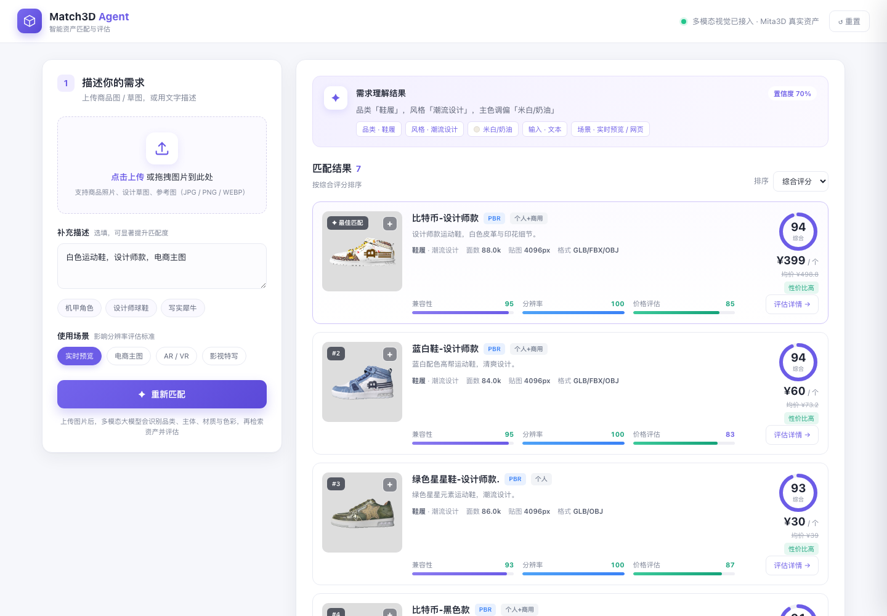
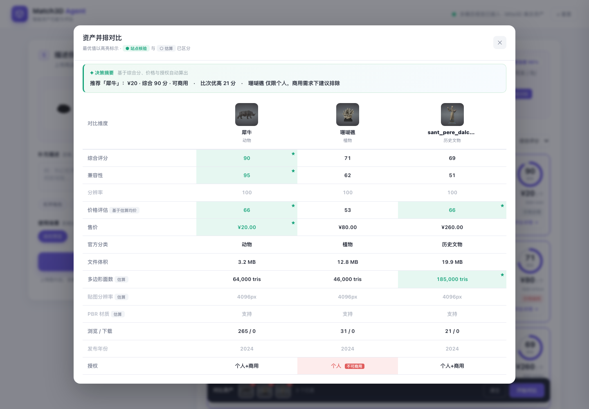
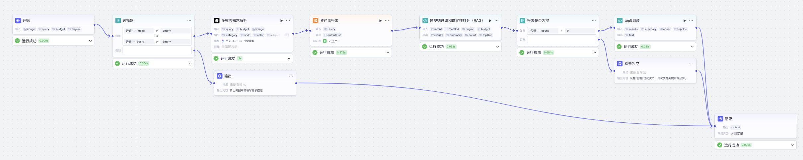

# Match3D Agent · 智能 3D 资产匹配与评估 Agent

> **上传参考图 / 草图 → 多模态理解 → RAG 检索 → 兼容性 · 画质 · 价格三维评估 → 给出「买哪个」的结论**

这是一个面向 3D 资产采购场景的**决策辅助 Agent**，也是一个 AI 产品经理的作品集项目。它的价值不在「帮人找东西」，而在**帮人在信息不全时快速做决策**。

**[▶ 在线演示](https://asset-match-agent.app.workbuddy.host/?sharecode=IWWADXEH6T)**

---

## 项目速览

| | |
|---|---|
| **我的角色** | AI 产品经理 · 独立定义问题、做取舍、推动落地 |
| **解决什么** | 把采购中「找与比」的过程，收敛成一句话结论：该买哪个、为什么 |
| **我的方法** | 多模态理解 → 相关性过滤 → 可解释评分 → 渐进披露 → 并排对比 |
| **交付形态** | ① 可运行前端原型（验证体验） ② 扣子 RAG 工作流（验证可规模化）——同一套逻辑的两端 |
| **验证基础** | 26 个真实平台资产 · 草图体积 −79% · 12 节点工作流跑通 |

> ⚠️ 数据边界：资产图片/售价/分类等取自平台公开信息；面数、贴图、PBR、市场均价为演示估算（界面以「估算」徽标区分）。[详见数据边界](#数据边界诚实声明)。

---

## 界面速览

**匹配结果**：需求理解标签 + 综合评分 + 三维评估，结论在前、归因按需展开



**并排对比**：决策摘要直给推荐项与理由，把「看表格」变成「得结论」



**扣子工作流**：12 节点全链路跑通，资产零内嵌、增减只改知识库



---

## 本地运行

无需构建，用任意静态服务器打开仓库根目录即可：

```bash
cd asset-matcher
python3 -m http.server 8000
# 或：npx serve .
```

浏览器访问 `http://localhost:8000`。前端直接调用云端多模态视觉 SDK，无需配置密钥或后端；26 张资产图已内联在 `js/images.js`，离线也能完整展示资产与评分逻辑。

---

## 目录结构

```
asset-matcher/
├── index.html + css/ + js/     # 产品原型：可运行的前端（图片已内联）
├── coze-export/                # 落地证据：扣子工作流的知识库、节点代码与接入说明
├── portfolio/                  # 支撑材料：实测截图与商业化推演
├── docs/                       # 深度文档：迭代记录、技术方案、推送指南
├── showcase/                   # 早期作品简历（已归档，以 portfolio/ 为准）
├── README.md
└── LICENSE                     # MIT（资产图片权利归原平台，见文件内说明）
```

两类内容各有用途：`index.html` + `coze-export/` 是**产品原型与落地证据**，`portfolio/` + `docs/` 是**作品集叙事材料**。

---

## 产品方案

1. **真实多模态理解**：理解文字、商品图、手绘草图，转成结构化的品类/风格/颜色/主体关键词——而非硬编码关键词的伪理解。
2. **可解释评分**：兼容性、画质、价格三维评估，兼容性与价格再拆因子；结论摆在最前，依据折叠起来，想深究再展开。
3. **相关性过滤**：两级锚点过滤，结果精准召回、不混入不相干资产——一次错误推荐就会损害信任。
4. **辅助决策**：并排对比直给「买哪个」，可商用优先、平局灰显、授权受限一票否决。
5. **可规模化设计**：资产放知识库走标准 RAG、与逻辑解耦，资产增减不改系统——第一天就定下的约束。

---

## 三个关键判断

从想法到可运行系统，三个判断决定了产品能否落地、能否规模化：

| 判断 | 结论 |
|---|---|
| **草图解析不准** | 文字里的具体名词强制覆盖图片解析名词，叠加两级锚点过滤，做到精准召回 |
| **降本不牺牲效果** | 图片侧裁白边压缩 −79%，模型侧选轻量视觉模型，单次识别约万分之二元 |
| **海量资产怎么办** | 结构化数据进关系库 + 向量检索混合召回；现在的 RAG + 零内嵌就是最小验证版 |

完整的「问题 → 我的判断 → 落地结果」见 **[docs/迭代记录.md](docs/迭代记录.md)**。

---

## 落地能力：把想法变成能跑的系统

我把方案完整推动到**可运行、可上线、可规模化**，交付两套可验证的形态：

- **可运行前端原型**：渐进披露、并排决策、草图压缩、文字名词纠错都在这里落地，可上手点、离线也能完整演示。
- **扣子 RAG 工作流**：同一套逻辑编排成 12 节点智能链路，资产零内嵌、增减只改知识库、可发布成 Bot / API。

两者验证的是同一套「理解→检索→打分→结论」逻辑的两端：前端用来上手体验，工作流用来证明能落地；产品化时前端改调工作流 API 即可对接。

**工程化思维体现在四处**：数据和逻辑解耦、成本可控（−79% + 轻量模型）、结果可复现（确定性规则打分）、风险提前识别。为什么这样选、三处落地风险是什么，见 **[docs/技术方案.md](docs/技术方案.md)**。

---

## 商业化模式（思考）

核心判断：**按「决策价值」收费，而非「工具功能」收费**——一次选错模型的返工成本，往往就超过一套工具年费。

1. **嵌入式选品助手**（最快落地）：给 3D 平台做助手，提升「搜索→购买」转化，按成交分成 / SaaS 年费。
2. **通用决策 API**（可规模化）：把「理解→召回→打分→结论」封装成 API，复制到家具、面料、工业件等非标品采购。
3. **评分规则与标签资产**（长期壁垒）：沉淀验证过的评分规则与结构化标签，形成可迁移的行业 know-how。

完整推演见 **[portfolio/商业化模式.md](portfolio/商业化模式.md)**。

---

## 数据边界（诚实声明）

- **真实数据**：售价、官方分类、文件体积、平台格式、浏览下载量、发布年份、资产与作者编号，取自平台公开可见信息。
- **演示估算**：多边形面数、贴图分辨率、PBR、LOD、市场均价基准与评分，因平台未公开，均为演示估算，界面中以「估算」徽标区分。
- **离线自足**：资产数据与图片已做离线快照，接口变更或下线也能完整演示。

---

## 项目材料

| 文件 | 内容 |
|---|---|
| `index.html` + `css/` + `js/` | 可运行前端原型（图片已内联） |
| `coze-export/` | 扣子工作流知识库、节点代码、接入说明与运行截图 |
| `portfolio/商业化模式.md` | 商业化模式完整推演 |
| `docs/迭代记录.md` | 三个关键判断的完整「问题 → 判断 → 结果」 |
| `docs/技术方案.md` | PM 视角的关键技术取舍与落地风险 |
| `docs/推送指南.md` | 仓库推送到 GitHub 的操作说明 |

---

*AI 产品经理 · 独立定义并推动落地 · 从问题定义到全链路跑通*
